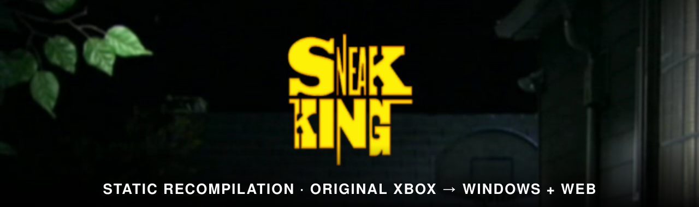
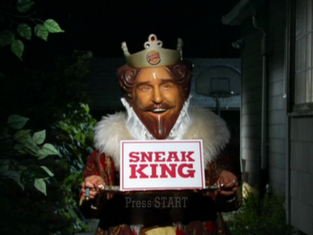

<p align="center"></p>

# Sneak King Recomp: a native PC port of Burger King: Sneak King

*Burger King: Sneak King* (2006, Blitz Games) for the original Xbox, statically recompiled into a native Windows game and an experimental WebAssembly browser build. No emulator: every function of the game's `default.xbe` is lifted from x86 to C, then compiled for the host with a small model of the Xbox around it.

Yes, this is a serious amount of engineering spent on a Burger King advergame. It's for the memes. :)

<p align="center"></p>

One checkout builds two versions of the game:

- **Windows** (Direct3D 9). This is the main version. It plays the whole game with keyboard and mouse or a pad. It adds widescreen, 360 HD textures, a debug overlay with cheats, and two joke modes.
- **Web** (WebAssembly, in Chrome). This one is experimental. It boots, plays the movies and menus, and runs the levels with the same controls, widescreen and cheats.

**This repo contains no game data.** You need a dump of your own disc. The ISO, the extracted files, the analysis and the lifted code all stay on your machine, and `.gitignore` covers them. 

## Contents

- [How it works](#how-it-works)
- [Setup](#setup)
  - [1. Install the tools](#1-install-the-tools)
  - [2. Get the code](#2-get-the-code)
  - [3. Dump the disc](#3-dump-the-disc)
  - [4. Lift the game](#4-lift-the-game)
  - [5a. Build and run on Windows](#5a-build-and-run-on-windows)
  - [5b. Build and run in the browser](#5b-build-and-run-in-the-browser)
  - [Optional extras](#optional-extras)
- [Controls](#controls)
- [Builds](#builds)
- [Cheats and joke modes](#cheats-and-joke-modes)
- [Troubleshooting](#troubleshooting)
- [Docs](#docs)
- [AI tools](#ai-tools)
- [Contributing](#contributing)
- [License](#license)

## How it works

1. **Lift.** The [xboxrecomp](https://github.com/sp00nznet/xboxrecomp) toolkit, vendored in `xboxrecomp/` with our patches, unpacks the disc, finds the game's roughly 13,650 functions and turns each one into C in `src/recomp/gen/`. Guest registers become globals and guest memory accesses become macros into one block of host memory.
2. **Runtime.** The toolkit's libraries stand in for the Xbox hardware the game talks to:
   - the kernel (threads, files, memory)
   - the audio processor
   - USB pads
   - just enough of the GPU for the game's graphics library to keep going
3. **Graphics.** The game's Direct3D 8 calls are intercepted and replayed on the host: Direct3D 9 on Windows (`src/d3d9_hle.c`), WebGL2 in the browser (`src/gl_hle.c`). The NV2A vertex programs are translated to HLSL or GLSL.
4. **Host.**
   - Windows: `src/main.c`, with a Win32 window, raw input and the bindings in `mkb.ini`.
   - Web: `src/main_web.c` and `src/web_host.c`, with a canvas and DOM input. Game files are fetched over HTTP as the game reads them.

Fixes go in `src/recomp_manual.c` or the toolkit, never in the generated code. `docs/BUILDING.md` explains each part in depth.

## Setup

Setup takes four stages. You install the tools, dump your disc, and lift the game once. Then you build either version, as often as you like.

### 1. Install the tools

| Tool | Needed for | Notes |
|---|---|---|
| Windows 10 or 11 | both | |
| [Visual Studio 2022](https://visualstudio.microsoft.com/vs/) (Community is fine) | both | Install the **Desktop development with C++** workload. It brings MSVC, CMake and Ninja. |
| [Python](https://www.python.org/downloads/) 3.11 or newer | both | For the lifting pipeline and the web server. |
| [Git](https://git-scm.com/) | both | |
| [Emscripten SDK](https://emscripten.org) | web only | Installed in step 5b. |
| Google Chrome | web only | The web build is tested in Chrome. |
| About 16 GB of RAM | both | The generated C files are large. |
| About 10 GB of disk | both | |

The build commands need MSVC on the `PATH`. Use one of these:

- **x64 Native Tools Command Prompt for VS 2022** from the Start menu.
- Or wrap each command:
  ```
  cmd /c '"C:\Program Files\Microsoft Visual Studio\2022\Community\VC\Auxiliary\Build\vcvars64.bat" >nul && <command>'
  ```

### 2. Get the code

```
git clone https://github.com/Guuzzeji/sneakking-recomp
cd sneakking-recomp
python -m venv .venv
.venv\Scripts\python.exe -m pip install capstone pytest pefile numpy
```

The toolkit is already in `xboxrecomp/`, so there's nothing else to clone.

### 3. Dump the disc

Make an ISO of your own *Sneak King* disc. A [Redump](http://redump.org/)-style dump of the US release is what this project was built against. Put the `.iso` in the repo root.

The disc is a hybrid: it holds both the original Xbox game and the Xbox 360 version. Only the original Xbox `default.xbe` is recompiled. The 360 files are optional extras; see [Optional extras](#optional-extras).

### 4. Lift the game

You do this once, and again only after changing `src/recomp_manual.c` overrides or the toolkit's lifter. Run it from PowerShell in the toolkit folder:

```powershell
cd xboxrecomp
$env:PYTHONIOENCODING = "utf-8"
$py = "..\.venv\Scripts\python.exe"
$x  = "..\game\default.xbe"
$a  = "..\analysis"
```

**4.1. Unpack the disc into `game/`** (about 1.6 GB):

```powershell
& $py -m tools.xiso unpack ..\<your-dump>.iso -o ..\game
& $py -m tools.xbe_parser $x --json ..\game\default_analysis.json
```

**4.2. Find every function.** This takes about 13 minutes:

```powershell
& $py -m tools.disasm $x -o $a\disasm --force `
    --seed-functions ..\seeds\p1_static.json `
    --seed-functions ..\seeds\p3_runtime.json `
    --seed-functions ..\seeds\p5_xpp.json
```

**4.3. Identify library functions and calling conventions:**

```powershell
& $py -m tools.func_id $x --functions $a\disasm\functions.json --strings $a\disasm\strings.json --xrefs $a\disasm\xrefs.json -o $a\func_id
& $py -m tools.abi_analysis $x --disasm-dir $a\disasm --func-id-dir $a\func_id --output-dir $a\abi
```

**4.4. Lift to C** in `src/recomp/gen/`:

```powershell
& $py -m tools.recomp $x --all --split 250 `
    --disasm-dir $a\disasm --func-id-dir $a\func_id --abi-dir $a\abi `
    --gen-dir ..\src\recomp\gen --game-name "Sneak King" `
    --exclude-manual ..\src\recomp_manual.c `
    --exclude-manual ..\src\d3d9_hle.c `
    --exclude-manual ..\src\d3d_hle_shared.h `
    --mmio-range 1EC5C0-20FB40 --mmio-range 23CB60-262FEC --mmio-range 2A65C0-2AFB10
cd ..
```

Keep every argument:
- The three `--exclude-manual` files tell the lifter which functions our code overrides or wraps. Without them, the link fails with unresolved `sub_X_gen` symbols.
- The three `--mmio-range` sections reach hardware registers through explicit calls. The web build needs them, and the Windows build works with them too, so one lift serves both.

You now have `game/`, `analysis/` and `src/recomp/gen/`, all gitignored.

### 5a. Build and run on Windows

From the repo root, in a VS developer prompt:

```
cmake --preset release
cmake --build --preset release
build\sneakking_recomp.exe
```

The first build compiles about 70 large generated files and takes a while. Later builds only compile what changed.

The exe needs no settings. It finds `game\` by walking up from its own folder, opens a window, and plays the intro movies. Press Escape or P (START) to skip them.

**From an IDE instead:**
- **Visual Studio 2022:** File > Open > Folder on the repo root, pick `release` in the preset dropdown, then press F5.
- **VS Code:** install the CMake Tools and C/C++ extensions, pick a preset in the status bar, and run the "Sneak King" launch configuration.

### 5b. Build and run in the browser

**1. Install the Emscripten SDK** next to the repo, in `..\emsdk` (where the `web` preset looks). From the repo root:

```
git clone https://github.com/emscripten-core/emsdk ..\emsdk
..\emsdk\emsdk install latest
..\emsdk\emsdk activate latest
```

If you install it somewhere else, add a `CMakeUserPresets.json` that inherits the `web` preset and sets `EMSDK`.

**2. Build** from the repo root (normal prompt; the script sets up MSVC's Ninja itself):

```
tools\web_build.cmd
```

This writes `build-web\sneakking_recomp.js` and `build-web\sneakking_recomp.wasm`, about 30 MB.

**3. Serve and play:**

```
.venv\Scripts\python.exe tools\serve.py
```

Open **http://localhost:8080/** in Chrome. The server:
- sends the COOP/COEP headers the page's threads need
- serves `game/` with range requests, so nothing is downloaded up front
- lists the game files for the page (`game/manifest.txt`, generated on request)
- listens on localhost only

The log under the picture shows boot progress, and the **Hide log** button folds it away. Click the picture once the King is in play to give it the mouse.

**Page options** go in the query string, for example `http://localhost:8080/?RECOMP_WIDESCREEN=0`:

| Option | Effect |
|---|---|
| `RECOMP_WIDESCREEN=0` | 4:3 instead of 16:9 |
| `RECOMP_HD_TEX=0` | the original Xbox textures instead of the 360 HD ones |
| `RECOMP_SCALE=1` | render at 640x480 (the default is 2x) |
| `RECOMP_D3D9_STATS=1` | log frames per second |

### Optional extras

- **360 HD textures.** `tools/xen_tex.py <pkg.xbp> <pkg.xen> -o game/hd` converts the 360 version's textures. Both builds use `game/hd` when it exists.
- **Joke modes** (Windows only). Shooter mode needs your own *Call of Duty 4* PC install, and skate mode needs your own *Skate 3* dump. `docs/MODS.md` has the extraction steps.
- **Debugging the web path natively.** `cmake --preset gl && cmake --build --preset gl` builds `build-gl\sneakking_recomp.exe`: the web renderer and memory layout as a Windows exe, so you can use the Visual Studio debugger.

## Controls

Both versions use the same layout.

| Input | Action |
|---|---|
| WASD | Move |
| Mouse | Camera (points at options in menus) |
| Shift | Run |
| Left click, Space | A (surprise, accept) |
| Right click, Q | B (back) |
| E | Y (hide, action) |
| F | First person |
| Wheel, Z | Zoom |
| Escape, P | Pause (START) |
| Arrows, Enter | Menus |

**Windows:**
- F1 opens the overlay (stats and cheats).
- F2 shows the frame rate.
- F9 frees the mouse.
- Edit the bindings in `mkb.ini`.
- A plugged-in Xbox controller works too.

**Web:**
- The cheats are buttons under the picture.
- Escape frees the mouse and a click takes it back.

## Builds

| Preset | Output | What it's for |
|---|---|---|
| `release` | `build\sneakking_recomp.exe` | The Windows game |
| `relwithdebinfo` | `out\build\relwithdebinfo\` | The same, with a PDB for debugging |
| `web` | `build-web\sneakking_recomp.{js,wasm}` | The browser build |
| `gl` | `build-gl\sneakking_recomp.exe` | The web build's renderer and memory layout on Windows |

## Cheats and joke modes

| | Windows | Web |
|---|---|---|
| Unlock levels, unlock missions, warp to a level | yes | yes |
| Shooter mode (CoD4 guns, third person) | yes | no |
| Skate mode (Skate 3 board) | yes | no |

## Troubleshooting

| Problem | Fix |
|---|---|
| `cl`, `cmake` or `ninja` not found | Use the VS developer prompt or the `vcvars64.bat` wrapper (step 1). |
| Link fails with unresolved `sub_X_gen` | The lift missed an `--exclude-manual` file. Run step 4.4 again with all three. |
| The web page says "Not cross-origin isolated" | Open it through `tools\serve.py`, not as a file or from another server. |
| The web build hangs on boot | The lift ran without the `--mmio-range` arguments. Run step 4.4 again and rebuild. |
| Black screen in the browser after a warp | A warp only works while you control the King, not during a load. |
| No sound and the game quits (Windows) | `RECOMP_AC97_READY` was set to `0`. Leave it unset. |

`docs/BUILDING.md` has more.

## Docs

| File | Contents |
|---|---|
| `docs/BUILDING.md` | How everything works, in depth |
| `docs/ROADMAP.md` | Phases and progress |
| `docs/RESEARCH.md`, `docs/P1_FINDINGS.md` | Background and findings about the game |
| `docs/WEB_PORT_RESEARCH.md` | The web port's design and results |
| `docs/MODS.md`, `docs/MW1_NOTES.md`, `docs/SKATE3_NOTES.md` | The joke modes |
| `docs/FUNNY_CHEATS.md` | Remaining work on the joke modes |
| `CLAUDE.md` | Working notes: every command, the `RECOMP_*` switches, debugging |

## AI tools

This project was built with [Claude Code](https://claude.com/claude-code), and `CLAUDE.md` holds its working notes. These add-ons help a lot:

| Tool | What it does here | Install |
|---|---|---|
| [REA](https://www.npmjs.com/package/rea-agents) (Reverse Engineer Anything) | MCP server for decompiling, xrefs and callers. `CLAUDE.md` tells the agent to use it for every reverse-engineering question, on `analysis/rea/default_flat.exe` and the reference games. Needs Node.js and Ghidra 12 (`GHIDRA_INSTALL_DIR`). | `npx rea-agents setup` |
| [Caveman](https://github.com/JuliusBrussee/caveman) | Makes Claude answer tersely, so long debugging sessions use fewer tokens. | `claude plugin marketplace add JuliusBrussee/caveman`<br>`claude plugin install caveman@caveman` |
| [Ponytail](https://github.com/DietrichGebert/ponytail) | Pushes Claude to the smallest fix that works, which keeps the overrides and the toolkit patches small. | `claude plugin marketplace add DietrichGebert/ponytail`<br>`claude plugin install ponytail@ponytail` |

Turn the plugins on in a session with `/caveman` and `/ponytail`.

## Contributing

Pull requests are welcome. Read [CONTRIBUTING.md](CONTRIBUTING.md) first. The short version: never commit game data, and never edit `src/recomp/gen/` by hand.

## License

The project's own code and docs are under the [MIT License](LICENSE). The vendored toolkit (`xboxrecomp/`) and Dear ImGui (`third_party/imgui/`) keep their own licenses. The game is not covered: you must own it.

---

*Burger King, Sneak King and the King are trademarks of their owners. This is an unofficial preservation and research project; it ships no game code or data.*
